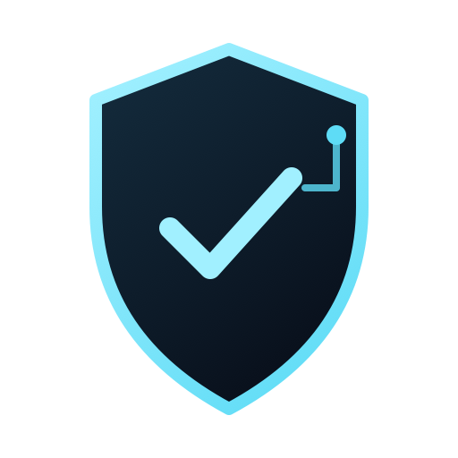

# Warden Pay



Authorization infrastructure for autonomous payments. Tempo moves the money; Warden proves it was allowed to move.

This project builds on [`@stlw/warden`](https://www.npmjs.com/package/@stlw/warden), an MIT-licensed policy and audit foundation. Warden Pay adds payment-specific rules, durable budget reservations, signed permits bound to MPP challenges, Tempo settlement, and the demo application. The Colosseum rules retain entrant IP and require entrants to disclose the status and ownership of third-party code included in a submission; see [the official rules, section 9](https://colosseum.com/legal/Crypto%20World's%20Fair%20Hackathon%20Rules.pdf).

## Development

Requires Node.js 22 or later. Copy `.env.example` to `.env`, fill the local testnet values, then run:

```sh
npm install
npm run db:up
npm run db:migrate
npm run typecheck
npm test
npm run test:db
```

The agent wallet and Warden authorization signer are separate keys. Generate a second, unfunded local signer with `cast wallet new`, and put its private key in `WARDEN_AUTH_PRIVATE_KEY` in `.env`. Generate the dashboard token with:

```sh
node -e "console.log(require('node:crypto').randomBytes(32).toString('hex'))"
```

Put it in `APPROVAL_TOKEN` in `.env`. Never paste either private key or the token into chat or commit `.env`. Start Docker, then run `npm run db:up` and `npm run db:migrate`. Run `npm run merchant`, `npm run api`, and `npm run pay` in separate terminals. The default paid request spends 3.20 testnet pathUSD. `npm run pay -- gpu-minute` waits for approval in the local dashboard at `http://127.0.0.1:8788`; `npm run pay -- large-transfer` demonstrates a denial without payment.

## Connect an agent (MCP)

Warden Pay includes a local MCP server for Claude Code, Codex, and OpenCode. The server exposes three tools:

- `list_paid_services` lists the demo services and fixed prices. It makes no payment and does not require Docker, `.env`, or a running merchant.
- `request_paid_service` sends a payment request through Warden policy, authorization, approval, and Tempo settlement.
- `get_payment_status` checks the run ID returned by a request. Run IDs live in memory for the lifetime of that MCP server process.

### Prerequisites

Use Node.js 22 or later. From the repository root, install dependencies:

```sh
npm install
```

The agent host starts the MCP server automatically; do not start `npm run mcp` in a separate terminal. Start the payment stack only if you plan to submit a request: follow [Development](#development) to configure the local `.env`, then start Postgres, the merchant, and the API. The merchant listens on `http://127.0.0.1:8787`; the approval dashboard is at `http://127.0.0.1:8788`.

### Configure the agent

Run the agent from the repository root so `node --import tsx src/mcp.ts` resolves the project dependencies and payment configuration.

**Claude Code** — add a user-local server entry for this project:

```sh
claude mcp add warden-pay --scope local -- node --import tsx src/mcp.ts
claude mcp list
```

The status should show `warden-pay` connected. Start a new Claude session after adding the server.

**Codex** — this repository includes [`.codex/config.toml`](.codex/config.toml). Open the repository as a trusted project in Codex, then start a new session. Project-level config is loaded only for trusted projects. If Codex does not load the project config, add the following to `~/.codex/config.toml`, replacing the working directory with this repository's absolute path:

```toml
[mcp_servers.warden_pay]
command = "node"
args = ["--import", "tsx", "src/mcp.ts"]
cwd = "/absolute/path/to/colloseum-warden-pay"
```

Or enable it for one CLI session without changing Codex settings:

```sh
codex -c 'mcp_servers.warden_pay={command="node",args=["--import","tsx","src/mcp.ts"],cwd="/absolute/path/to/colloseum-warden-pay"}'
```

**OpenCode** — the repository includes a project [`opencode.json`](opencode.json) with the local MCP server enabled. From the repository root, check the connection with:

```sh
opencode mcp list
```

Start a new session after changing MCP settings. In Claude, use `/mcp` to inspect connected servers; in Codex, use `/mcp`; in OpenCode, run `opencode mcp list`. If Codex does not load the project config, use the one-session command above.

### Safe smoke test

Ask the agent:

> Use only Warden Pay's `list_paid_services` tool. Do not call `request_paid_service`. List each service and its price.

Expected result: `browser-session` — 3.20 pathUSD, `gpu-minute` — 32 pathUSD, and `large-transfer` — 420 pathUSD. This check is read-only and spends nothing.

### Payment demo

Payment requests require the local payment stack and valid `.env` settings. Keep private keys and `APPROVAL_TOKEN` local; never put them in agent prompts. The MCP process starts the payment CLI, which reads `.env` locally.

For a **no-spend policy denial**, ask the agent to request `large-transfer`. Policy should deny the 420 pathUSD crypto-transfer request before settlement. For a **human approval demo**, request `gpu-minute` (32 pathUSD). Open the dashboard, then choose **Deny** to finish without spending. Approving it settles a 32 pathUSD testnet payment. The agent receives a run ID; after resolving the dashboard prompt, ask it to call `get_payment_status` with that ID.

The `browser-session` service costs 3.20 pathUSD and can settle without human approval. Do not request it unless you intend to spend testnet funds. Never configure the agent host to auto-approve Warden payment requests; dashboard approval is the human control.

See the [Colosseum submission and recording materials](https://github.com/isiomaC/stalewell-docs/tree/main/hackathons/colosseum-2026/warden-pay) and [SECURITY.md](SECURITY.md) for the audit guarantee and its limits.
